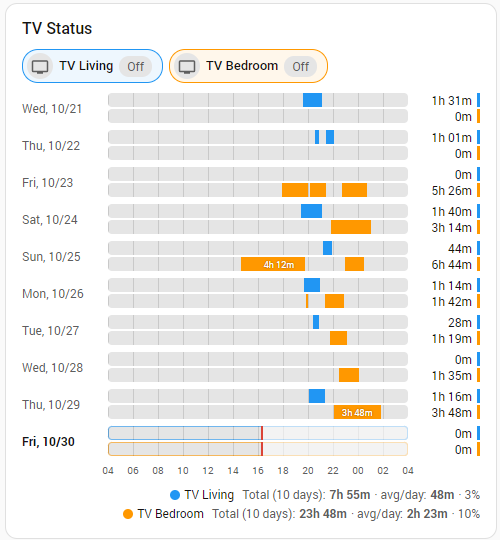
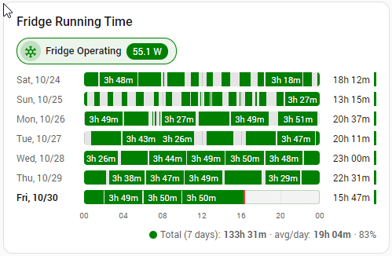

# Status Timeline Card

[](https://my.home-assistant.io/redirect/hacs_repository/?owner=Gaudi111&repository=status-timeline-card&category=plugin)


[](https://hacs.xyz)
[](https://github.com/Gaudi111/status-timeline-card/actions/workflows/validate.yml)
· [Changelog](CHANGELOG.md)


Lovelace card showing the **on/off history of up to 3 entities** as **grouped horizontal bars per day**, with the **total on-time** and **duty cycle %** on the right of each bar.

Based on the idea of [schedule-timeline-card](https://github.com/andregoncalvespires/schedule-timeline-card) by andregoncalvespires, reworked to read recorded history.


## What's new in 2026.11.2
- **How long ON / OFF** in the state chip, e.g. `On · 2h 15m` (`show_on_duration`, `show_off_duration`).
- **Running indicator**: today's total is shown in a colored box (or with an `ON` badge) while the entity is ON.
- Full history in [CHANGELOG.md](CHANGELOG.md).

## Features
- **Up to 3 entities** per card, clustered bars per day, each with its **own color**.
- **Total on-time** and **duty cycle %** per bar.
- **How long ON / OFF** shown in each state chip (selectable independently).
- **Running indicator** on today's total while the entity is ON.
- **Current state chips** in each entity's color, using the configured ON/OFF mapping; numeric threshold entities also show the live value.
- **OFF mapping** (`off_states`): e.g. treat `unavailable` / `unknown` as OFF.
- **Duration inside each ON block**, shown only when it fits.
- **Logical day**: `day_start` / `day_end` (e.g. 04:00 → 04:00), validated so days never overlap.
- **1 to 10 days**, newest or oldest first, optionally excluding the current day.
- Per-entity summary (total, average, duty cycle), hour axis, now marker, tooltips, `on_above`, `invert`,
  time zone / DST aware, visual editor, ES / EN / PT.

## Installation
**Marketplace / HACS (recommended)**: click the button above, or search for *Status Timeline Card*
(Settings → Marketplace on Home Assistant 2026.11+, or HACS on older versions). Download, then reload the browser (Ctrl+F5).

**Custom repository** (until the card is listed in the store): HACS → ⋮ → Custom repositories → `https://github.com/Gaudi111/status-timeline-card`, category **Dashboard** → download → Ctrl+F5.

**Manual**: copy `status-timeline-card.js` to `/config/www/` and add `/local/status-timeline-card.js?v=2026.11.2` as a JavaScript module resource (change `?v=` on each update).


## Usage
```yaml
type: custom:status-timeline-card
title: Water system
day_start: "04:00"
day_end: "04:00"
days: 7
off_states: [unavailable, unknown]
entities:
  - entity: binary_sensor.water_pump
    name: Pump
    color: "#2196f3"
  - entity: switch.pressure_booster
    name: Booster
    color: "#ff9800"
  - entity: sensor.heater_power
    name: Heater
    color: "#e91e63"
    on_above: 10          # W → chip shows "152.3 W │ On"
```

## Current-state chips
| Entity type | Chip content |
|---|---|
| Numeric with `on_above` | `Name │ value with unit │ On/Off` (status from the threshold rule, honoring `invert`). Hover: `152.3 W > 10 W (threshold) → On`. |
| Numeric with `on_above`, state not numeric (e.g. `unavailable`) | `Name │ status` following `off_states` (Off if mapped, otherwise Unavailable). |
| Other entities | `Name │ state` according to `state_display`. |

The status badge can also show how long the entity has been in its current state, e.g. `On · 2h 15m`:
`show_on_duration` (default `true`) and `show_off_duration` (default `false`), card-wide or per entity.
For numeric threshold entities the time counts from when the threshold was crossed, not from the last value change.
If the period started before the loaded history, it is shown as `≥ 3d 4h`.

Set `show_value: false` (card-wide or per entity) to hide the value and keep only the status. The value uses Home Assistant's formatting, so unit and decimals follow the entity's display precision setting.

## Running indicator
While an entity is ON, its total for the current day keeps increasing. `running_indicator` highlights it:

| Value | Look |
|---|---|
| `box` (default) | Total inside a rounded box in the entity color |
| `badge` | Small `ON` pill left of the total |
| `none` | No indicator |

## Duty cycle
`duty cycle = on-time / considered time`

| `duty_cycle_basis` | Considered time | Current day at 16:00 (day starts 04:00, 6 h on) |
|---|---|---|
| `elapsed` (default) | Time elapsed in the day (full window for past days) | 6 / 12 h = **50%** |
| `window` | Full day window, always | 6 / 24 h = **25%** |
| `available` | Elapsed time minus unavailable / unrecorded time | 6 / 10 h = **60%** (with 2 h unavailable) |

## Day window rules
| `day_start` → `day_end` | Result |
|---|---|
| `04:00` → `04:00` | Full 24 h day, 04:00 to 04:00 next day. |
| `06:00` → `02:00` | 20 h day ending 02:00 next day. |
| `04:00` → `06:00` | **Rejected**: would overlap the next day and count records twice. |
| `08:00` → `20:00` + `partial_day: true` | Same-day window 08:00–20:00 only. |

## Options
### Card
| Option | Default | Description |
|---|---|---|
| `entities` | – | List (max 3) of entity IDs or objects (see below). |
| `entity` | – | Single entity (backward compatible). |
| `title` | – | Optional card title. |
| `day_start` / `day_end` | `00:00` | Logical day window (see rules above). |
| `partial_day` | `false` | Allow `day_end` > `day_start` as a same-day window. |
| `days` | `7` | 1–10. |
| `include_today` | `true` | `false` = completed days only. |
| `order` | `newest_first` | or `oldest_first`. |
| `show_total` | `true` | Total on-time right of each bar. |
| `total_format` | `hm` | `hm` (5h 07m) or `decimal` (5.12 h). |
| `running_indicator` | `box` | `box`, `badge` or `none`: highlight today's total while the entity is ON. |
| `show_on_duration` | `true` | Show how long the entity has been ON in the state chip. |
| `show_off_duration` | `false` | Show how long the entity has been OFF in the state chip. |
| `show_duty_cycle` | `true` | Duty cycle % right of the total. |
| `duty_cycle_basis` | `elapsed` | `elapsed`, `window` or `available`. |
| `duty_cycle_decimals` | `0` | 0–2. |
| `show_state` | `true` | Current-state chips with color reference. |
| `state_display` | `mapped` | `mapped`, `mapped_only` or `raw` (non-threshold entities). |
| `show_value` | `true` | Show the live value in chips of numeric threshold entities. |
| `show_block_values` | `true` | Duration inside ON blocks when it fits. |
| `block_value_min_ms` | `0` | Only label blocks at least this long. |
| `show_summary` / `show_hours` / `show_now` / `show_unavailable` | `true` | Footer, axis, now marker, hatched unavailable. |
| `on_states` | on, open, home, … | Default ON states. |
| `off_states` | `[]` | Default states forced to OFF (checked first). |
| `on_above` / `invert` | – / `false` | Default numeric threshold / count OFF time. |
| `row_height` | `0` (auto: 18 single, 14 grouped) | Bar height px. In-bar labels need ≥ 12. |
| `hour_step` | `0` (auto) | Hours between axis labels. |
| `refresh_interval` | `300` | History reload seconds. |
| `time_zone` | `auto` | `auto`, `server`, `local`. |
| `off_color` / `unavailable_color` | theme | Bar background / hatch color (see *Colors*). |

### Per entity
| Option | Description |
|---|---|
| `entity` | Required. |
| `name` / `icon` | Overrides. |
| `color` | CSS color or `[r, g, b]` (see *Colors*). Defaults: blue, orange, green. |
| `on_states`, `off_states`, `on_above`, `invert`, `show_value`, `show_on_duration`, `show_off_duration` | Override the card defaults. |

### State classification order
1. In `off_states` → **OFF**
2. `unavailable` / `unknown` → **unavailable** (hatched, not counted as ON)
3. `on_above` (numeric) → ON if value > threshold
4. `on_states` → ON, anything else OFF
`invert` swaps ON/OFF.

## Colors
`color`, `off_color` and `unavailable_color` accept:

| Format | Example |
|---|---|
| Hex | `"#2196f3"`, `"#fff"` |
| Named | `red`, `teal` |
| Functions | `"rgb(33,150,243)"`, `"rgba(0,0,0,.5)"`, `"hsl(200 80% 50%)"` |
| Theme variable | `"var(--accent-color)"`, `"var(--my-color, #fff)"` |
| RGB list | `[33, 150, 243]` |

Values must be a valid CSS color and may not contain `; { } < > " ' \` `` ` `` or `@`.
Invalid values are ignored (a warning is logged in the browser console and shown in the visual editor) and the default color is used.

## Screenshots



## Notes
- History comes from the recorder; for 10 previous days set `recorder: purge_keep_days: 14`.
- With `day_start: "04:00"`, at 02:00 Tuesday the current row is still Monday.

## License
MIT. Original idea credited to schedule-timeline-card by andregoncalvespires.
