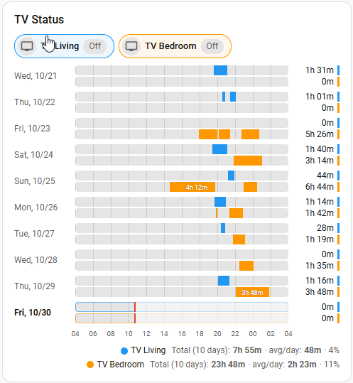
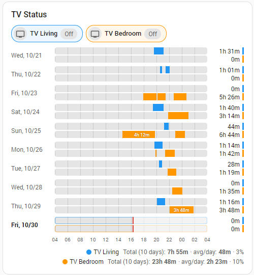
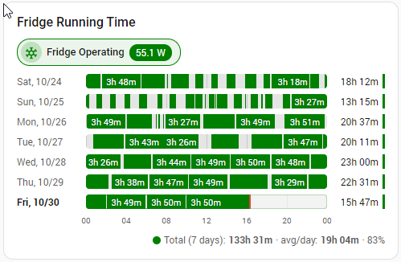

# Status Timeline Card


[](https://hacs.xyz)
[](https://github.com/Gaudi111/status-timeline-card/actions/workflows/validate.yml)
· [Changelog](CHANGELOG.md)



Lovelace card showing the **on/off history of up to 3 entities** as **grouped horizontal bars per day**, with the **total on-time** and **duty cycle %** on the right of each bar.

Based on the idea of [schedule-timeline-card](https://github.com/andregoncalvespires/schedule-timeline-card) by andregoncalvespires, reworked to read recorded history.

## What's new in 2026.10.4
- **Duty cycle %** column to the right of the total, with selectable basis (elapsed / full day / available time) and 0–2 decimals.
- Full history in [CHANGELOG.md](CHANGELOG.md).

## Features
- **Up to 3 entities** per card, clustered bars per day, each with its **own color**.
- **Total on-time** and **duty cycle %** per bar.
- **Current state chips** in each entity's color, using the configured ON/OFF mapping.
- **OFF mapping** (`off_states`): e.g. treat `unavailable` / `unknown` as OFF.
- **Duration inside each ON block**, shown only when it fits.
- **Logical day**: `day_start` / `day_end` (e.g. 04:00 → 04:00), validated so days never overlap.
- **1 to 10 days**, newest or oldest first, optionally excluding the current day.
- Per-entity summary (total, average, duty cycle), hour axis, now marker, tooltips, `on_above`, `invert`,
  time zone / DST aware, visual editor, ES / EN / PT.

## Installation
**HACS**: ⋮ → Custom repositories → `https://github.com/Gaudi111/status-timeline-card`, category **Dashboard** → install → Ctrl+F5.
**Manual**: copy `status-timeline-card.js` to `/config/www/` and add `/local/status-timeline-card.js?v=2026.10.4` as a JavaScript module resource (change `?v=` on each update).

## Usage
```yaml
type: custom:status-timeline-card
title: Water system
day_start: "04:00"
day_end: "04:00"
days: 7
off_states: [unavailable, unknown]
show_duty_cycle: true
duty_cycle_basis: elapsed
duty_cycle_decimals: 0
entities:
  - entity: binary_sensor.water_pump
    name: Pump
    color: "#2196f3"
  - entity: switch.pressure_booster
    name: Booster
    color: "#ff9800"
  - entity: sensor.heater_power
    name: Heater
    color: "#e91e63"
    on_above: 10
```

## Duty cycle
`duty cycle = on-time / considered time`

| `duty_cycle_basis` | Considered time | Current day at 16:00 (day starts 04:00, 6 h on) | Use when |
|---|---|---|---|
| `elapsed` (default) | Time elapsed in the day (full window for past days) | 6 / 12 h = **50%** | You want a live, comparable rate. |
| `window` | Full day window, always | 6 / 24 h = **25%** | You want today's value to grow toward the final figure. |
| `available` | Elapsed time minus unavailable / unrecorded time | 6 / 10 h = **60%** (with 2 h unavailable) | Sensor outages should not lower the %. |

States mapped with `off_states` count as OFF (included in the considered time). The footer percentage uses the same basis over all displayed days.

## Day window rules
| `day_start` → `day_end` | Result |
|---|---|
| `04:00` → `04:00` | Full 24 h day, 04:00 to 04:00 next day. |
| `06:00` → `02:00` | 20 h day ending 02:00 next day. |
| `04:00` → `06:00` | **Rejected**: would overlap the next day and count records twice. |
| `08:00` → `20:00` + `partial_day: true` | Same-day window 08:00–20:00 only. |

## Options
### Card
| Option | Default | Description |
|---|---|---|
| `entities` | – | List (max 3) of entity IDs or objects (see below). |
| `entity` | – | Single entity (backward compatible). |
| `title` | – | Optional card title. |
| `day_start` / `day_end` | `00:00` | Logical day window (see rules above). |
| `partial_day` | `false` | Allow `day_end` > `day_start` as a same-day window. |
| `days` | `7` | 1–10. |
| `include_today` | `true` | `false` = completed days only. |
| `order` | `newest_first` | or `oldest_first`. |
| `show_total` | `true` | Total on-time right of each bar. |
| `total_format` | `hm` | `hm` (5h 07m) or `decimal` (5.12 h). |
| `show_duty_cycle` | `true` | Duty cycle % right of the total. |
| `duty_cycle_basis` | `elapsed` | `elapsed`, `window` or `available` (see above). |
| `duty_cycle_decimals` | `0` | 0–2. |
| `show_state` | `true` | Current-state chips with color reference. |
| `state_display` | `mapped` | `mapped`, `mapped_only` or `raw`. |
| `show_block_values` | `true` | Duration inside ON blocks when it fits. |
| `block_value_min_ms` | `0` | Only label blocks at least this long. |
| `show_summary` / `show_hours` / `show_now` / `show_unavailable` | `true` | Footer, axis, now marker, hatched unavailable. |
| `on_states` | on, open, home, … | Default ON states. |
| `off_states` | `[]` | Default states forced to OFF (checked first). |
| `on_above` / `invert` | – / `false` | Default numeric threshold / count OFF time. |
| `row_height` | `0` (auto: 18 single, 14 grouped) | Bar height px. In-bar labels need ≥ 12. |
| `hour_step` | `0` (auto) | Hours between axis labels. |
| `refresh_interval` | `300` | History reload seconds. |
| `time_zone` | `auto` | `auto`, `server`, `local`. |
| `off_color` / `unavailable_color` | theme | Bar background / hatch color. |

### Per entity
| Option | Description |
|---|---|
| `entity` | Required. |
| `name` / `icon` | Overrides. |
| `color` | CSS color or `[r, g, b]`. Defaults: blue, orange, green. |
| `on_states`, `off_states`, `on_above`, `invert` | Override the card defaults. |

### State classification order
1. In `off_states` → **OFF**
2. `unavailable` / `unknown` → **unavailable** (hatched, not counted as ON)
3. `on_above` (numeric) → ON if value > threshold
4. `on_states` → ON, anything else OFF
`invert` swaps ON/OFF.


## Screenshots



## Notes
- History comes from the recorder; for 10 previous days set `recorder: purge_keep_days: 14`.
- With `day_start: "04:00"`, at 02:00 Tuesday the current row is still Monday.

## License
MIT. Original idea credited to schedule-timeline-card by andregoncalvespires.
